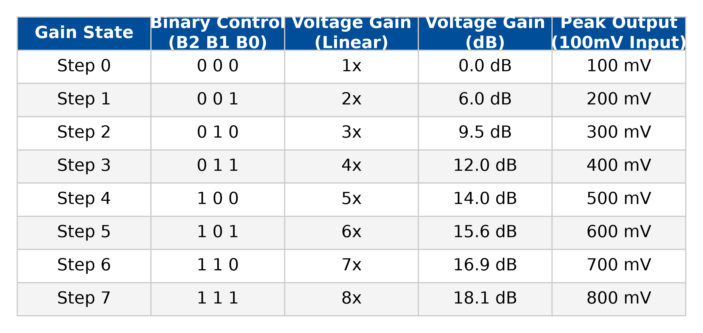
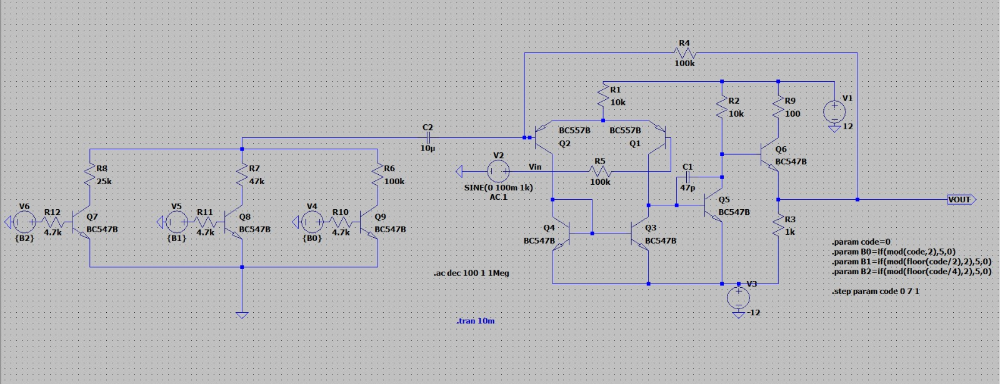
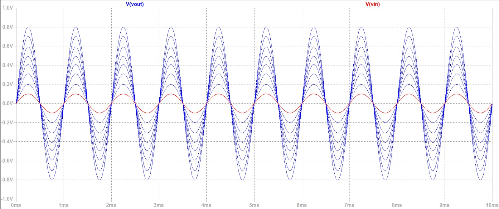
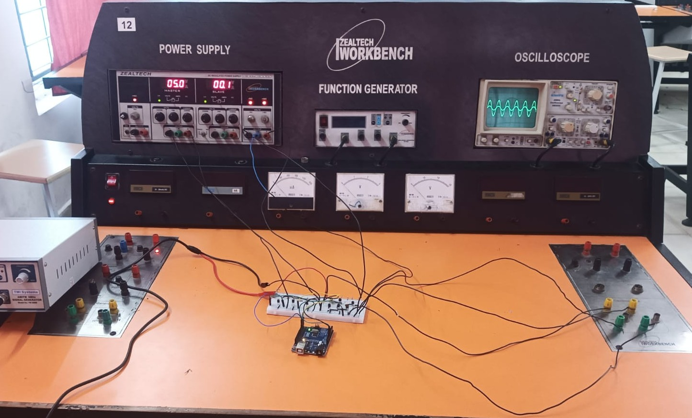
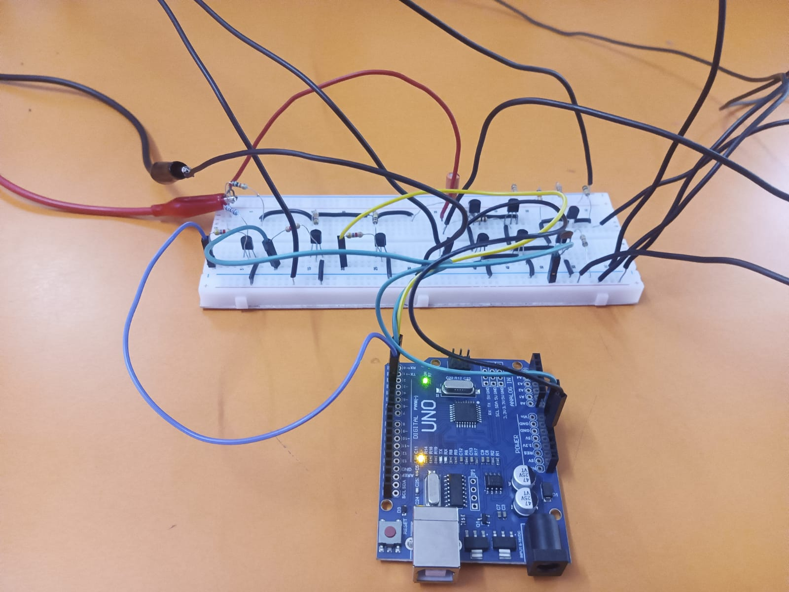
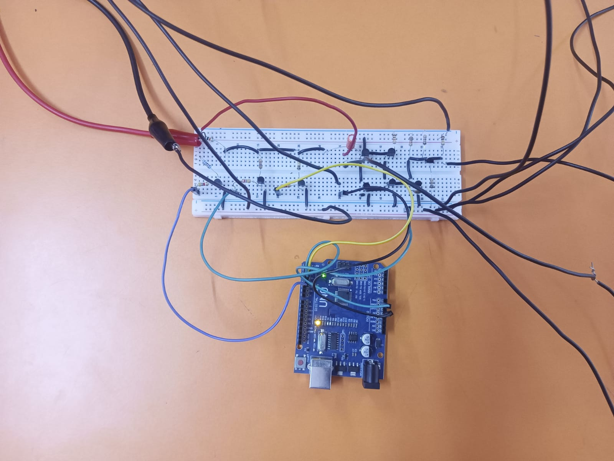
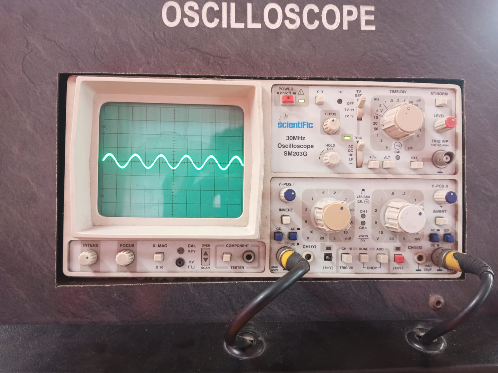
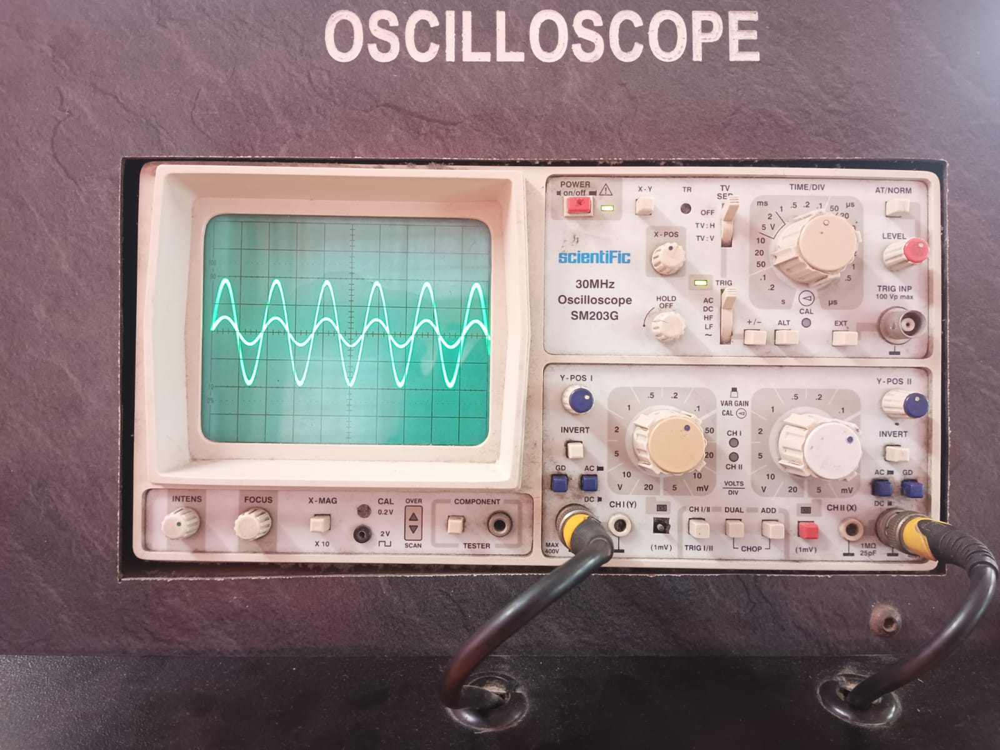
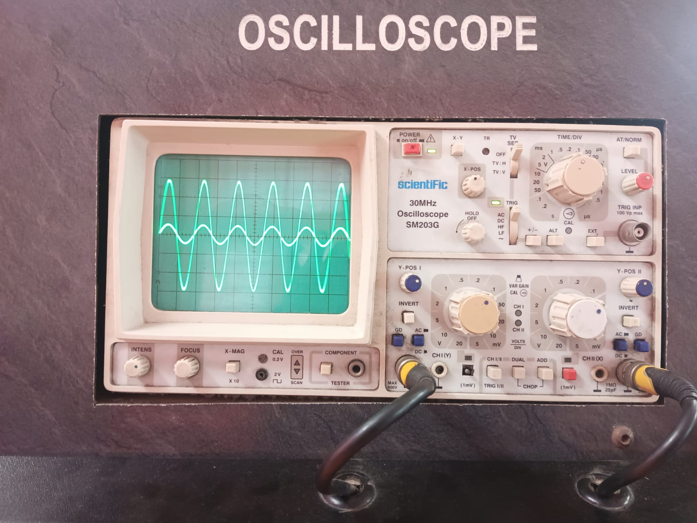
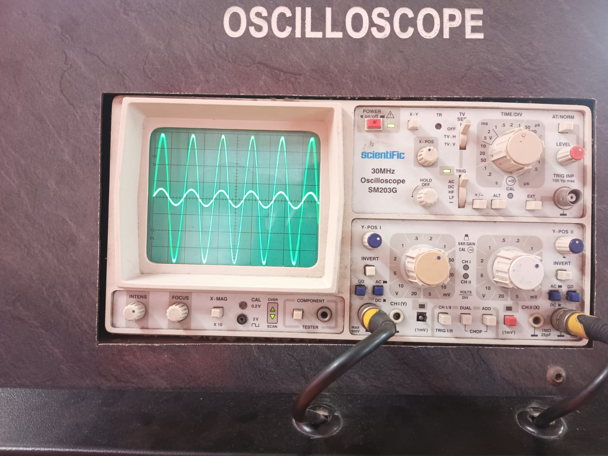

# BJT Programmable Gain Amplifier (PGA)

A programmable gain amplifier built entirely from discrete Bipolar Junction Transistors — designed, simulated in LTspice, and validated on hardware with all eight gain states confirmed on an oscilloscope.

Course project, *Electronic Circuits* (BEVD204L), Vellore Institute of Technology, Chennai.

---

## Specifications

| Parameter | Value |
|---|---|
| Topology | Discrete op-amp: differential input pair → current-mirror active load → voltage amplifier stage → output buffer |
| Active devices | 9 BJTs — 7 × BC547B (NPN), 2 × BC557B (PNP) |
| Gain control | 3-bit digital, 8 discrete steps (000–111) |
| Maximum gain | 8× |
| Input voltage range | 1 mV – 1.2 V |
| Supply | ±12 V dual rail |
| Compensation | 47 pF |
| Intended use | Low-frequency message signals — **not** intended for high-frequency carrier signals |

## 3-Bit Gain Control

The amplification factor is set digitally through three binary inputs — **B2** (MSB), **B1**, and **B0** (LSB).

Each control bit drives the base of a switching transistor in the input network. When a bit is driven HIGH, its transistor turns on and connects a specific parallel resistor to ground, altering the equivalent AC impedance of the feedback network around the differential amplifier. As the binary input increments from `000` to `111`, the equivalent resistance to ground falls and the closed-loop voltage gain rises correspondingly, scaling up to the maximum 8×.



## Circuit Design

The core is a discrete operational amplifier: a differential input pair with a current-mirror active load, followed by a voltage amplifier stage and an output buffer.



LTspice source: [`Circuit/BJT-PGA.asc`](Circuit/BJT-PGA.asc)

## Simulation

Simulated in LTspice to verify transient response, signal integrity, and stability across all programmable gain states. Test stimulus: 100 mV, 1 kHz sine input on a ±12 V supply.



## Hardware Implementation

The circuit was constructed on a breadboard and tested. Each of the eight gain steps was verified against its expected output on an oscilloscope.

### Breadboard setup

<p align="center">
  
  
  
</p>

### Measured gain steps

| Binary | Scope capture |
|---|---|
| `000` | [Step 0](Hardware/Step-0.jpeg) |
| `001` | [Step 1](Hardware/Step-1.jpeg) |
| `010` | [Step 2](Hardware/Step-2.jpeg) |
| `011` | [Step 3](Hardware/Step-3.jpeg) |
| `100` | [Step 4](Hardware/Step-4.jpeg) |
| `101` | [Step 5](Hardware/Step-5.jpeg) |
| `110` | [Step 6](Hardware/Step-6.jpeg) |
| `111` | [Step 7](Hardware/Step-7.jpeg) |

<p align="center">
  
  
  
  
</p>

## Repository structure

```
Circuit/     LTspice schematic (.asc) and circuit diagram
Software/    Simulation results
Hardware/    Breadboard build photos and oscilloscope captures for all 8 gain steps
Gain_Table.png
```

## Contributors

This was a team course project.

- [Maadeshwar](https://github.com/Maadeshwar) — original repository: [BJT-Programmable-Gain-Amplifier](https://github.com/Maadeshwar/BJT-Programmable-Gain-Amplifier)
- [Thirugnanam V S](https://github.com/Thiru2006)

## License

MIT — see [LICENSE](LICENSE). Original copyright retained.
